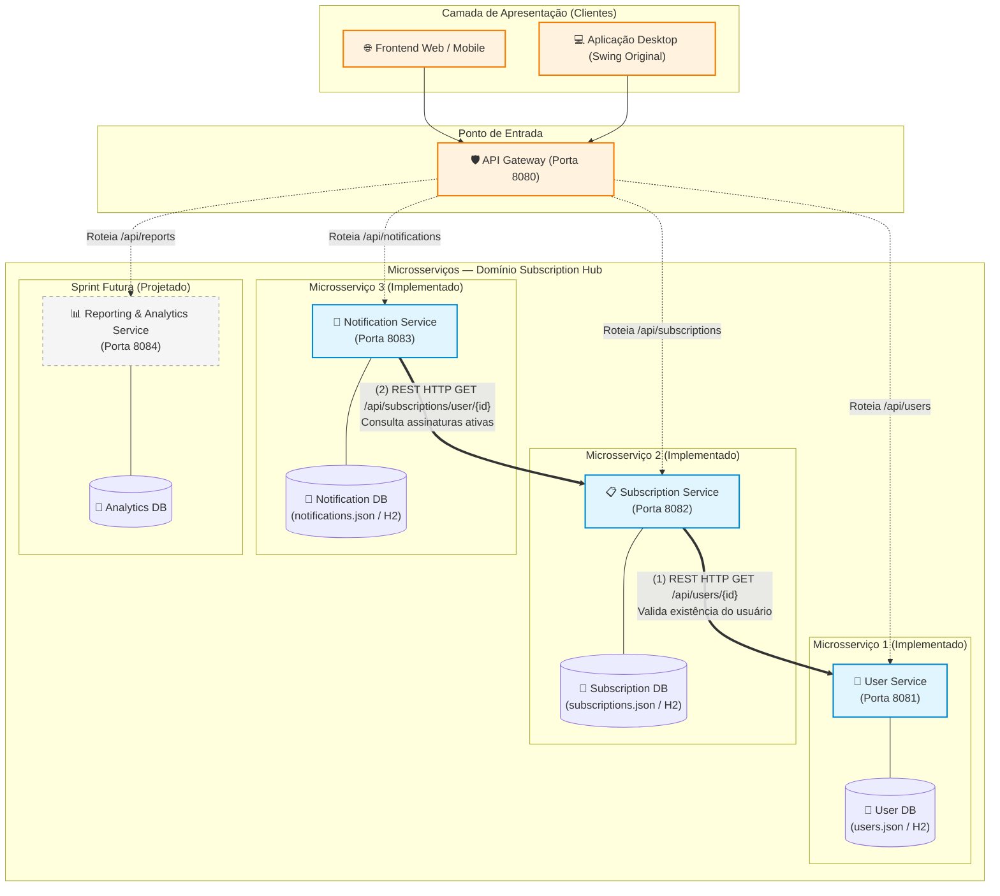

# 🚀 PLANO DE EXECUÇÃO — SPRINT 07
## Arquitetura, Implementação e Testes de Microsserviços
**Projeto:** Subscription Hub  
**Disciplina:** Práticas de Arquitetura e Engenharia de Software (PAES)  
**Data:** Novembro de 2026  

---

## 📌 Sumário Executivo

Este plano foi desenvolvido para orientar a equipe na transição arquitetural do **Subscription Hub** de sua base monolítica original (Java Swing com persistência em arquivos) para um modelo baseado em **Microsserviços Independentes**.

O plano contempla as 6 partes exigidas na especificação da Sprint:
1. **Parte I:** Definição da Arquitetura Completa e Justificativa Técnica.
2. **Parte II:** Implementação Independente de 3 Microsserviços com Comunicação REST síncrona.
3. **Parte III:** Testes Unitários Automatizados (mínimo de 12 testes isolados com JUnit 5 + Mockito).
4. **Parte IV:** Testes de Integração e APIs REST (curl / Postman / Insomnia).
5. **Parte V:** Documentação Técnica, Contratos de API e instruções no README.
6. **Parte VI:** Planejamento e Distribuição no Jira com rastreabilidade Git.

---

## 🗺️ 1. Parte I — Definição da Arquitetura do Subscription Hub

### 1.1. Decomposição Funcional e Identificação dos Microsserviços
A análise do domínio do *Subscription Hub* (gestão financeira de assinaturas recorrentes, alertas de cobrança e geração de relatórios) resultou na identificação de **4 microsserviços essenciais**, acrescidos de um **API Gateway**:

| Microsserviço | Responsabilidade Principal | Funcionalidades Oferecidas | Base de Dados / Persistência | Dependências / Comunicação | Implementado na Sprint 07? |
| :--- | :--- | :--- | :--- | :--- | :---: |
| **User Service** *(Serviço de Usuários)* | Gestão de identidade, autenticação e perfil do usuário | • Cadastro de usuários<br>• Autenticação (login/senha)<br>• Consulta e validação de existência do usuário | Base própria (`users_db` / `users.json`) | Não consome outros microsserviços diretamente. | **SIM (MS-1)** ✅ |
| **Subscription Service** *(Serviço de Assinaturas)* | Ciclo de vida completo das assinaturas de serviços (streaming, SaaS, etc.) | • Criação de assinatura com categorização<br>• Atualização de valores e periodicidade<br>• Cancelamento/pausa de assinaturas<br>• Listagem de assinaturas por usuário | Base própria (`subscriptions_db` / `subscriptions.json`) | Consome **User Service** via REST para validar se o usuário existe e está ativo antes de cadastrar uma assinatura. | **SIM (MS-2)** ✅ |
| **Notification / Alert Service** *(Serviço de Notificações)* | Gestão de lembretes, cálculo de vencimentos e disparos de alertas | • Varredura diária de vencimentos<br>• Cálculo de antecedência configurável<br>• Registro e consulta de alertas pendentes | Base própria (`notifications_db` / `notifications.json`) | Consome **Subscription Service** via REST para obter as assinaturas ativas com vencimento próximo. | **SIM (MS-3)** ✅ |
| **Reporting / Analytics Service** *(Serviço de Relatórios)* | Consolidação analítica e geração de métricas financeiras | • Compilação de gastos mensais e anuais<br>• Distribuição percentual por categoria<br>• Exportação de relatórios (CSV/PDF) | Base própria de consolidação ou cache analítico | Consome **Subscription Service** para coletar dados históricos consolidados. | *Planejado (Sprint Futura)* ⏳ |
| **API Gateway** | Ponto de entrada unificado para clientes (Mobile, Web, GUI Swing) | • Roteamento reverso<br>• Balanceamento e segurança básica | Stateless | Encaminha requisições aos microsserviços internos. | *Planejado (Sprint Futura)* ⏳ |

---

### 1.2. Diagrama da Arquitetura Completa



---

### 1.3. Justificativa Arquitetural
1. **Critério de Separação (Single Responsibility Principle & Bounded Contexts):**  
   - O domínio de autenticação e conta (`User`) tem ciclo de vida e requisitos de segurança distintos do catálogo e controle de faturamento (`Subscription`).
   - O mecanismo de alertas (`Notification`) possui natureza assíncrona/temporal (agendamentos de verificação de prazos), não devendo sobrecarregar a base de dados de assinaturas em tempo real.
2. **Independência de Dados (Database-per-Service):**  
   - Cada serviço é proprietário de suas tabelas/arquivos. O `Subscription Service` **nunca** faz query direta no arquivo ou banco de dados do `User Service`; ele consome a API REST deste último.
3. **Comunicação Inter-serviços:**  
   - A comunicação é síncrona via REST/HTTP (JSON), empregando tratamento de erros (`Circuit Breaker` conceitual / timeouts e retorno de fallback amigável em caso de serviço destino fora do ar).
4. **Benefícios:**  
   - Escalabilidade granular (ex: o serviço de notificações pode rodar em horários de pico noturno sem afetar a escrita de assinaturas).
   - Manutenibilidade e isolamento de falhas: a queda do serviço de relatórios ou de notificações não impede o usuário de cadastrar uma nova assinatura.
5. **Dificuldades e Mitigações:**  
   - *Latência de rede e dependência de chamadas HTTP*: resolvida com DTOs compactos e timeouts bem definidos.
   - *Consistência eventual*: gerenciamento de integridade referencial via aplicação e contratos de API bem estruturados.

---

## 💻 2. Parte II — Especificação dos 3 Microsserviços a Implementar

### 2.1. Escolha Tecnológica Recomendada
Para garantir facilidade de compilação, independência e conformidade com o edital sem adicionar complexidade desnecessária:
- **Tecnologia Principal:** **Java 17+** com **Spring Boot** (ou uma versão desacoplada em 3 subprojetos Maven com `spring-boot-starter-web` e `spring-boot-starter-test`).
- **Persistência Independente:** Cada microsserviço terá seu próprio diretório de dados (`data/users/`, `data/subscriptions/`, `data/notifications/`) utilizando persistência JSON/H2 autônoma.
- **Formato:** JSON em 100% das requisições e respostas.

---

### 2.2. Microsserviço 1: User Service (Porta `8081`)
- **Responsabilidade:** Gestão de usuários e autenticação.
- **Endpoints:**
  - `POST /api/users`: Cadastro de usuário. Retorna `201 Created` ou `400 Bad Request` (dados inválidos) / `409 Conflict` (e-mail duplicado).
  - `POST /api/users/login`: Autenticação. Retorna `200 OK` com dados do usuário ou `401 Unauthorized`.
  - `GET /api/users/{id}`: Consulta dados de um usuário pelo ID. Retorna `200 OK` ou `404 Not Found`.

---

### 2.3. Microsserviço 2: Subscription Service (Porta `8082`)
- **Responsabilidade:** Gestão das assinaturas do usuário.
- **Endpoints:**
  - `POST /api/subscriptions`: Criação de assinatura. Valida regras internas e consulta o **User Service** (`GET /api/users/{usuarioId}`) para verificar se o usuário existe. Retorna `201 Created`, `400 Bad Request` ou `422 Unprocessable Entity` (usuário inexistente).
  - `GET /api/subscriptions/user/{usuarioId}`: Retorna todas as assinaturas de um usuário específico (`200 OK`).
  - `GET /api/subscriptions/{id}`: Retorna os detalhes de uma assinatura específica (`200 OK` ou `404 Not Found`).
  - `PUT /api/subscriptions/{id}/cancel`: Altera o status da assinatura para `CANCELADA` (`200 OK` ou `400/404`).
  - `DELETE /api/subscriptions/{id}`: Exclusão de assinatura (`204 No Content` ou `404 Not Found`).

---

### 2.4. Microsserviço 3: Notification Service (Porta `8083`)
- **Responsabilidade:** Regras de negócio de alertas e vencimentos iminentes.
- **Endpoints:**
  - `POST /api/notifications/check-expiring`: Dispara a verificação de assinaturas a vencer para um usuário ou para todos. Consome o **Subscription Service** (`GET /api/subscriptions/user/{userId}`), calcula quais estão a $X$ dias do vencimento e persiste os alertas gerados. Retorna `200 OK` com os alertas gerados.
  - `GET /api/notifications/user/{usuarioId}`: Retorna a lista de notificações ativas do usuário (`200 OK`).
  - `PUT /api/notifications/{id}/read`: Marca uma notificação como lida (`200 OK` ou `404 Not Found`).

---

### 2.5. Operação de Comunicação REST Obrigatória (Seção 3.2 do Edital)
- **Serviço Solicitante (Origem):** `Subscription Service` (porta `8082`).
- **Serviço Provedor (Destino):** `User Service` (porta `8081`).
- **Operação de Negócio:** *Validação de Usuário no Cadastro de Assinatura*.
  - Ao receber a requisição `POST /api/subscriptions` contendo `{ "usuarioId": 1, "nomeServico": "Netflix", "valor": 55.90, ... }`:
  - O `Subscription Service` dispara uma requisição HTTP `GET http://localhost:8081/api/users/1`.
  - **Sucesso:** Se o `User Service` responder `200 OK`, a assinatura é salva e o `Subscription Service` responde `201 Created`.
  - **Falha de Domínio:** Se o `User Service` responder `404 Not Found`, a criação da assinatura é abortada com resposta `422 Unprocessable Entity` e mensagem `"Usuário não encontrado"`.
  - **Tratamento de Falha de Comunicação:** Se o `User Service` estiver indisponível (timeout / conexão recusada), o `Subscription Service` captura a exceção, não permite salvar dados inconsistentes e responde `503 Service Unavailable` com corpo informativo claro.

---

## 🧪 3. Parte III — Plano de Testes Unitários Automatizados (12 Casos Mínimos)

Para cada microsserviço, serão implementados casos de testes automatizados com **JUnit 5** e **Mockito** (isolando banco e chamadas externas via mock).

### 3.1. Matriz de Rastreabilidade dos Testes Unitários

| Microsserviço | ID Teste | Funcionalidade / Regra de Negócio | Cenário Testado | Resultado Esperado | Tipo |
| :--- | :--- | :--- | :--- | :--- | :---: |
| **User Service** | `UT-US-01` | Registro de Usuário | Dados válidos e e-mail inédito | Usuário cadastrado com sucesso, ID gerado | Sucesso |
| **User Service** | `UT-US-02` | Registro de Usuário | E-mail já cadastrado na base | Rejeição com exceção de conflito de e-mail | Erro / Validação |
| **User Service** | `UT-US-03` | Autenticação (Login) | Credenciais corretas (e-mail e senha) | Retorno do usuário autenticado | Sucesso |
| **User Service** | `UT-US-04` | Autenticação (Login) | Senha incorreta informada | Falha de autenticação (retorna nulo ou erro 401) | Erro / Validação |
| **Subscription Service** | `UT-SS-01` | Cadastro de Assinatura | Dados válidos e usuário validado via User Client Mock | Assinatura salva com status "ATIVA" | Sucesso |
| **Subscription Service** | `UT-SS-02` | Cadastro de Assinatura | Valor da assinatura negativo ou zero | Rejeição por validação de valor inválido | Erro / Validação |
| **Subscription Service** | `UT-SS-03` | Cadastro de Assinatura | Usuário inexistente (User Client Mock retorna vazio/404) | Rejeição da criação da assinatura com erro | Erro / Dependência |
| **Subscription Service** | `UT-SS-04` | Cancelamento de Assinatura | Assinatura existente e ativa | Status alterado para "CANCELADA" | Sucesso |
| **Notification Service** | `UT-NS-01` | Verificação de Vencimentos | Assinatura com vencimento dentro do intervalo (ex: 3 dias) | Alerta criado com mensagem e data corretas | Sucesso |
| **Notification Service** | `UT-NS-02` | Verificação de Vencimentos | Nenhuma assinatura próxima do vencimento | Lista de alertas gerados vazia, sem inconsistência | Sucesso |
| **Notification Service** | `UT-NS-03` | Cálculo de Alertas | Dias de antecedência com valor negativo | Rejeição por validação de argumento inválido | Erro / Validação |
| **Notification Service** | `UT-NS-04` | Resiliência de Comunicação | Subscription Service mockado falha/timeout | Tratamento da exceção com log e sem quebra do serviço | Erro / Resiliência |

---

## 🔌 4. Parte IV — Testes de Integração e APIs REST (Roteiro de Evidências)

Será disponibilizado um script automatizado (`test_apis.bat` ou script curl) e uma coleção Postman com os cenários obrigatórios para geração das evidências:
1. **Evidência 1 — Consulta com Sucesso:** `GET http://localhost:8081/api/users/1` ou `GET http://localhost:8082/api/subscriptions/user/1`.
2. **Evidência 2 — Cadastro/Alteração com Sucesso:** `POST http://localhost:8082/api/subscriptions` com dados válidos.
3. **Evidência 3 — Comunicação Inter-serviços Funcionando:** Criação de assinatura no `Subscription Service` disparando consulta no `User Service`.
4. **Evidência 4 — Requisição Inválida / Erro com Código HTTP Adequado:**
   - Criação de assinatura com valor negativo (`400 Bad Request`).
   - Tentativa de associar assinatura a usuário inexistente `999` (`422 Unprocessable Entity`).
5. **Evidência 5 — Inicialização Independente:** Comprovação dos três serviços rodando em portas distintas (`8081`, `8082`, `8083`) e respondendo de forma autônoma.

---

## 📋 5. Parte V — Estrutura de Documentação & README

O repositório será organizado de forma clara:
```text
SubscriptionHub/
├── docs/
│   ├── arquitetura.md          # Diagramas, justificativas técnicas e escolhas
│   ├── apis.md                 # Contratos Swagger / OpenAPI / Exemplos de Requests e Responses
│   └── evidencias_testes.md    # Prints e logs de execução dos testes unitários e curl/Postman
├── services/
│   ├── user-service/           # Microsserviço 1 (Porta 8081)
│   │   ├── src/
│   │   ├── pom.xml (ou build.gradle)
│   │   └── README.md
│   ├── subscription-service/   # Microsserviço 2 (Porta 8082)
│   │   ├── src/
│   │   ├── pom.xml
│   │   └── README.md
│   └── notification-service/   # Microsserviço 3 (Porta 8083)
│       ├── src/
│       ├── pom.xml
│       └── README.md
├── scripts/
│   ├── start-all.bat           # Inicializa os 3 microsserviços simultaneamente
│   └── run-unit-tests.bat      # Executa todos os testes unitários de todos os microsserviços
├── README.md                   # Instruções centrais de execução passo a passo para o avaliador
└── PLANO_SPRINT_07.md          # Este plano de execução
```

---

## 🎯 6. Parte VI — Backlog de Tarefas para o Jira

Abaixo está o detalhamento estruturado para cadastro imediato no quadro do Jira da equipe:

| ID da Tarefa | Título da Tarefa | Descrição Detalhada | Responsável Sugerido | Status Inicial | Critérios de Aceitação (DoD) |
| :--- | :--- | :--- | :--- | :---: | :--- |
| **SH-101** | *Definição da Arquitetura e Diagramas* | Elaborar diagrama formal dos microsserviços e justificativa arquitetural conforme seção 2 do edital. | Arquiteto / Membro 1 | To Do | Diagrama completo em Mermaid/PNG e arquivo de justificativa técnica no repositório. |
| **SH-102** | *Configuração da Estrutura de Pastas e Módulos* | Criar a estrutura multi-serviços no repositório com build independente para os 3 serviços. | Dev 1 | To Do | Três subprojetos inicializáveis independentemente via Maven ou scripts. |
| **SH-103** | *Implementação do User Service (MS-1)* | Implementar endpoints REST de cadastro, login e busca de usuário por ID na porta 8081 com persistência isolada. | Dev 2 | To Do | Endpoints `POST /api/users`, `POST /api/users/login` e `GET /api/users/{id}` funcionais com JSON. |
| **SH-104** | *Implementação do Subscription Service (MS-2)* | Implementar CRUD de assinaturas e regras de negócio de datas e periodicidade na porta 8082. | Dev 3 | To Do | Endpoints `POST`, `GET`, `PUT /cancel` funcionais com base de dados própria. |
| **SH-105** | *Implementação da Comunicação REST Inter-serviços* | Implementar cliente HTTP no Subscription Service para consultar o User Service antes de cadastrar uma assinatura. | Dev 2 / Dev 3 | To Do | `Subscription Service` valida `usuarioId` no `User Service` via REST e trata erros de conectividade. |
| **SH-106** | *Implementação do Notification Service (MS-3)* | Implementar motor de cálculo de vencimentos e endpoints de consulta de alertas na porta 8083. | Dev 1 | To Do | Consulta assinaturas via REST no MS-2 e gera alertas salvos em persistência isolada. |
| **SH-107** | *Implementação dos Testes Unitários do User Service* | Escrever os 4 testes unitários com JUnit 5 para cadastro e login (sucesso e falhas). | QA / Membro 4 | To Do | 4 testes passando com asserções claras e sem dependência externa. |
| **SH-108** | *Implementação dos Testes Unitários do Subscription Service* | Escrever os 4 testes unitários com JUnit 5 + Mockito para o serviço de assinaturas. | QA / Membro 4 | To Do | 4 testes passando, cobrindo validação de valores e mock do cliente User Service. |
| **SH-109** | *Implementação dos Testes Unitários do Notification Service* | Escrever os 4 testes unitários com JUnit 5 + Mockito para o cálculo de alertas e vencimentos. | QA / Membro 4 | To Do | 4 testes passando, cobrindo cenários com e sem vencimentos próximos e tratamento de erro. |
| **SH-110** | *Execução e Coleta de Evidências das APIs (curl/Postman)* | Testar os endpoints e a comunicação integrada, gerando evidências de sucesso e de códigos de erro. | Dev 1 / QA | To Do | Prints/logs de execução registrados em `docs/evidencias_testes.md` e coleção Postman exportada. |
| **SH-111** | *Elaboração do README.md e Instruções de Execução* | Consolidar documentação com passo a passo claro para o professor rodar os serviços e os testes. | Toda a equipe | To Do | README contendo pré-requisitos, comandos de start, portas e execução dos testes. |

---

## ⚡ 7. Próximos Passos Imediatos para a Equipe

1. **Revisar e Aprovar este Plano com o Grupo:** Garantir que todos concordam com os 3 microsserviços escolhidos (`User`, `Subscription` e `Notification`).
2. **Cadastrar as Tarefas no Jira:** Utilizar a tabela da Seção 6 para criar os cartões no Jira, definindo os responsáveis e prazos.
3. **Iniciar a Implementação Técnica Sequencial:**
   - Passo 1: Estruturar a pasta `services/` com os três microsserviços.
   - Passo 2: Implementar e testar o `User Service` e seus testes unitários.
   - Passo 3: Implementar o `Subscription Service` com a chamada REST ao `User Service` e seus testes unitários com Mockito.
   - Passo 4: Implementar o `Notification Service` e seus testes unitários.
   - Passo 5: Rodar os testes de API integrados e compilar todas as evidências e documentação.

