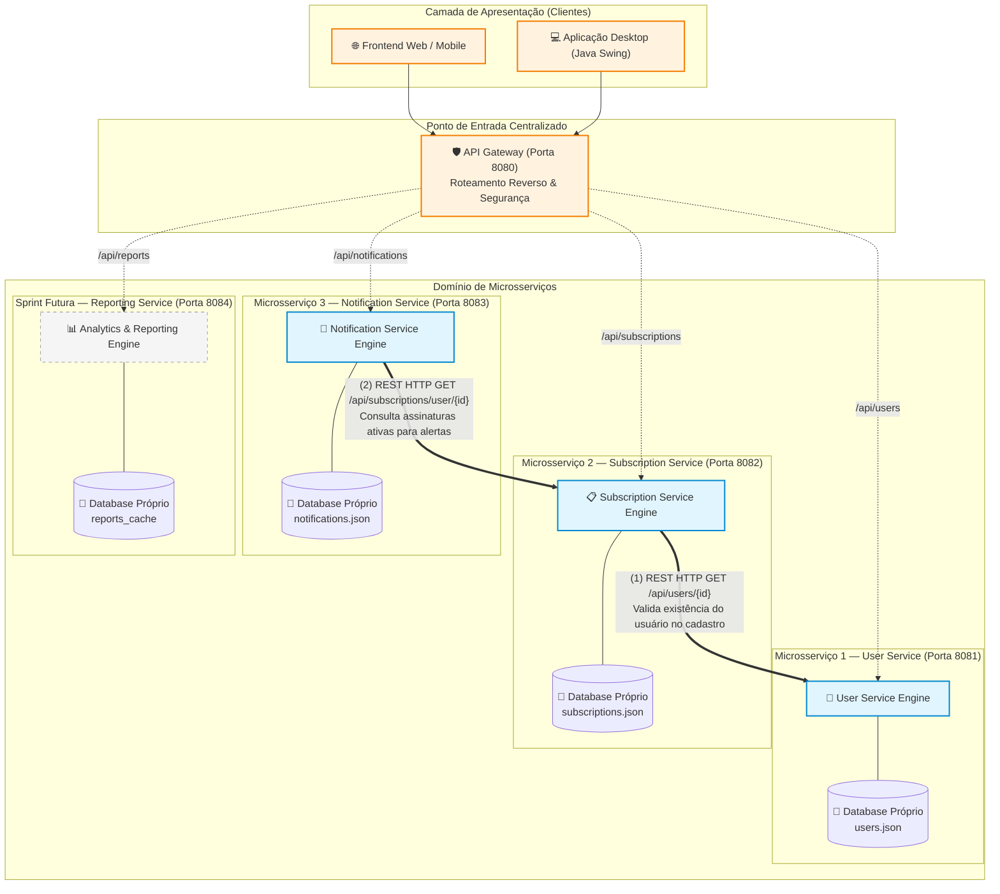

# 🏛️ Documento de Arquitetura de Microsserviços
## Projeto: Subscription Hub
**Disciplina:** Práticas de Arquitetura e Engenharia de Software (PAES)  
**Sprint 07:** Arquitetura, Implementação e Testes de Microsserviços  

---

## 1. Visão Geral da Arquitetura

O **Subscription Hub** evoluiu de uma arquitetura monolítica centrada em interface gráfica desktop (Java Swing com arquivos CSV) para uma **Arquitetura Baseada em Microsserviços**.

A solução foi projetada para desacoplar as áreas de negócio do sistema, proporcionando:
- Isolamento de falhas.
- Escalabilidade independente.
- Independência no ciclo de desenvolvimento e deploy de cada módulo por desenvolvedores diferentes.

---

## 2. Diagrama da Arquitetura Completa

---

## 3. Especificação dos Microsserviços

| Microsserviço | Responsabilidade Principal | Funcionalidades Oferecidas | Dados sob sua Responsabilidade | Dependências e Comunicação | Status na Sprint 07 |
| :--- | :--- | :--- | :--- | :--- | :---: |
| **User Service** | Identidade, autenticação e perfil do usuário | • Cadastro de usuário • Login com senha • Consulta de perfil por ID | `id`, `nome`, `email`, `senha` (`data/users.json`) | Não consome outros microsserviços diretamente. | **IMPLEMENTADO (MS-1)** |
| **Subscription Service** | Ciclo de vida e gestão de assinaturas recorrentes | • Cadastro de assinaturas • Consulta por usuário ou ID • Cancelamento de assinaturas | `id`, `usuarioId`, `nomeServico`, `valor`, `dataVencimento`, `status`, `categoria`, `periodicidade` (`data/subscriptions.json`) | Consome via REST o **User Service** (`GET /api/users/{id}`) para validar o usuário antes de cadastrar uma assinatura. | **IMPLEMENTADO (MS-2)** |
| **Notification Service** | Cálculo e disparo de alertas de vencimento próximo | • Verificação periódica de vencimentos • Notificação com antecedência configurável • Registro e leitura de alertas | `id`, `usuarioId`, `assinaturaId`, `mensagem`, `dataCriacao`, `lida` (`data/notifications.json`) | Consome via REST o **Subscription Service** (`GET /api/subscriptions/user/{id}`) para analisar assinaturas ativas. | **IMPLEMENTADO (MS-3)** |
| **Reporting Service** | Consolidação analítica e relatórios financeiros | • Gastos consolidados por categoria • Totais mensais/anuais • Exportação de relatórios | Dados consolidados de métricas e histórico analítico | Consome o **Subscription Service** para sumarizar valores. | *Projetado (Sprint Futura)* |

---

## 4. Justificativa Arquitetural

### 4.1. Por que o sistema foi dividido nesses microsserviços?
A divisão foi orientada pelo princípio dos **Contextos Delimitados (*Bounded Contexts*)** do *Domain-Driven Design (DDD)* e pelo **Princípio da Responsabilidade Única (*Single Responsibility Principle*)**:
1. O domínio de **Identidade e Acesso** (`User`) possui requisitos de confidencialidade, hash de credenciais e taxas de alteração muito diferentes do catálogo de serviços.
2. O domínio de **Faturamento e Assinaturas** (`Subscription`) é o núcleo transacional do sistema, sofrendo modificações frequentes (troca de planos, cancelamentos, atualizações de preços).
3. O domínio de **Alertas e Notificações** (`Notification`) tem características predominantemente temporais e reativas (disparos periódicos baseados em datas), não devendo acoplar seu processamento às rotinas de escrita de assinaturas.

### 4.2. Como será definida a responsabilidade sobre os dados?
Foi adotado o padrão **Database-per-Service**:
- Cada microsserviço possui controle exclusivo sobre seus arquivos/tabelas de persistência (`data/users.json`, `data/subscriptions.json`, `data/notifications.json`).
- É expressamente proibido a um serviço acessar diretamente o arquivo ou schema de outro. Toda e qualquer troca de informação ocorre estritamente por meio de **interfaces públicas de APIs REST em formato JSON**.

### 4.3. Como ocorre a comunicação inter-serviços e como tratar falhas?
- A comunicação é síncrona via HTTP/REST utilizando JSON.
- **Tolerância a Falhas e Resiliência:**
  - O `Subscription Service` utiliza timeouts estritos (3 segundos) ao contatar o `User Service`.
  - Se o `User Service` estiver fora do ar, o `Subscription Service` não permite o registro de dados órfãos/inconsistentes e responde com `503 Service Unavailable`, informando o cliente com clareza.
  - O `Notification Service` captura exceções de rede amigavelmente caso o serviço de assinaturas esteja inacessível, evitando quedas em cascata (*cascading failures*).

### 4.4. Benefícios e Dificuldades da Arquitetura
- **Benefícios:**
  - *Autonomia de desenvolvimento:* Cada integrante do grupo desenvolve, testa e faz deploy de seu serviço em uma branch separada, eliminando conflitos de merge.
  - *Isolamento de falhas:* A eventual sobrecarga ou indisponibilidade do serviço de notificações não impede o usuário de logar ou criar uma assinatura.
  - *Clareza de testes:* Regras de negócio são testadas com facilidade através de mocks de clientes HTTP usando Mockito.
- **Dificuldades e Mitigações:**
  - *Necessidade de gerenciar múltiplos processos:* Mitigada pela criação de scripts de orquestração automatizada (`start-all.bat` e `run-tests.bat`).
  - *Consistência de dados distribuídos:* Garantida pela validação síncrona prévia na borda do domínio antes de persistir entidades vinculadas.

